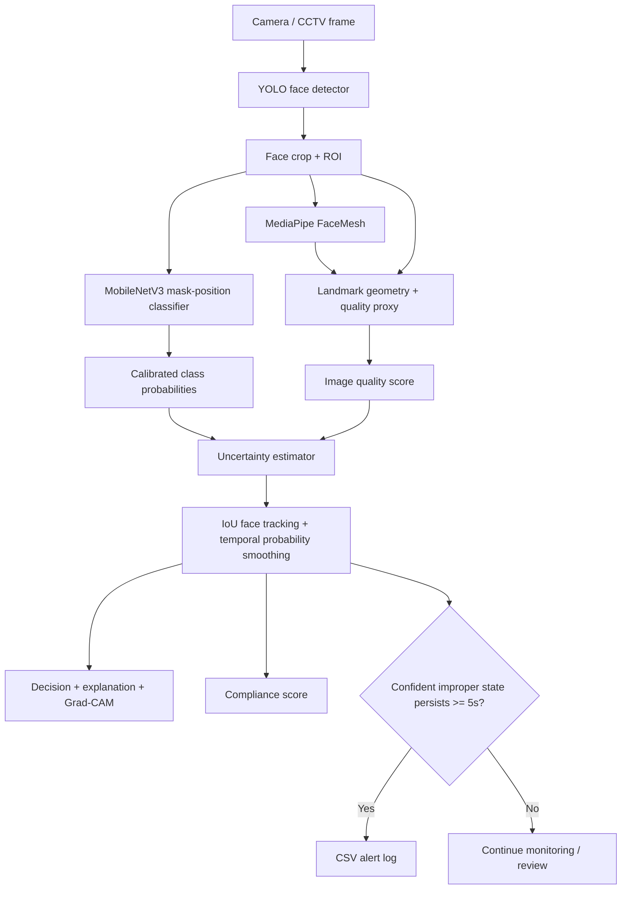

# System architecture and mathematical definitions

## Classification labels

| Index-independent label | Meaning |
|---|---|
| `correctly_worn` | Nose and mouth region appears covered |
| `nose_exposed` | Nose is uncovered |
| `mouth_exposed` | Mouth is uncovered |
| `below_chin` | Mask is positioned beneath the chin |
| `no_mask` | No mask is worn |

## Quality score

Let `B` be blur quality from Laplacian variance, `L` illumination quality, `S` face-size suitability and `K` landmark availability. Each component is scaled to `[0,1]`.

\[
Q = 0.35B + 0.25L + 0.25S + 0.15K
\]

The `occlusion_risk` field is currently a proxy inferred from the availability of landmarks, not a direct occlusion segmentation model.

## Uncertainty

For class probabilities \(p_i\), confidence is \(C=\max_i p_i\), and normalized entropy is:

\[
H(p)=-\frac{\sum_i p_i\log(p_i)}{\log K}
\]

The implementation combines entropy, low confidence and poor image quality:

\[
U=0.55H(p)+0.35(1-C)+0.10(1-Q)
\]

The current default thresholds are configurable in `config.yaml`. When confidence/quality is inadequate, the display uses `REVIEW` rather than a categorical alert.

## Temporal verification

Bounding boxes are associated between adjacent frames by greedy Intersection over Union (IoU). The last `N` probability vectors are averaged:

\[
\bar p_t=\frac{1}{N}\sum_{j=t-N+1}^{t}p_j
\]

A violation timer starts only when the temporally smoothed prediction is improper and the current frame is not uncertain. The timer resets on a correct prediction, poor-quality evidence or uncertain result. An alert is logged when the timer reaches the configured duration (default 5 seconds).

## Compliance score

\[
S_c=100(0.50P_c+0.20R_c+0.20Q+0.10C)
\]

where `P_c` is the temporal mean probability of `correctly_worn`, `R_c` is the recent fraction of frames predicted correctly worn, `Q` is average quality and `C` is average confidence. The weights are engineering choices for this prototype and should be ablated/tuned on validation data before a research claim is made.

## Explainability

The app can generate Grad-CAM from the last convolutional feature block of MobileNetV3. The natural-language explanation states the predicted position reason and notes missing landmarks, poor quality or high uncertainty. Grad-CAM indicates influential image regions; it is not a causal explanation and should not be interpreted as proof that a specific facial part is uncovered.
